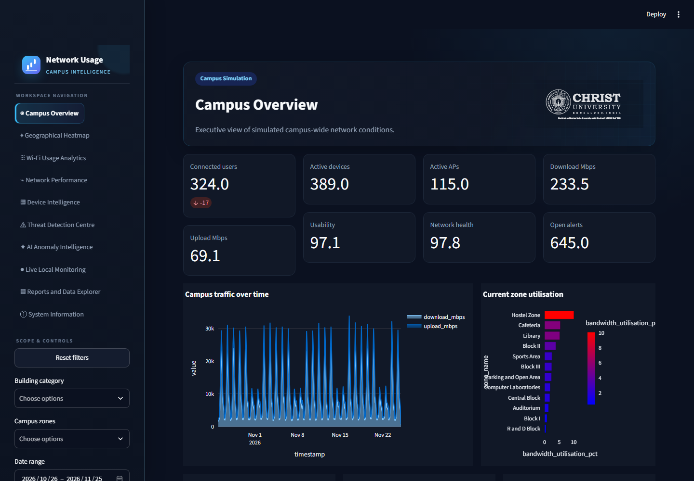
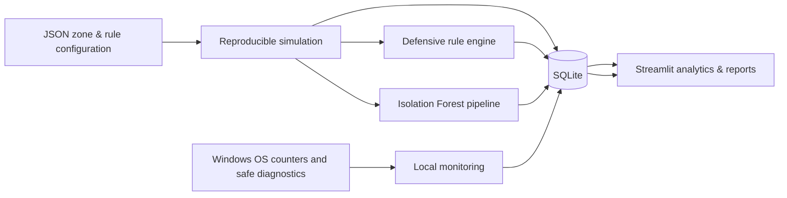

# Network Usage

**Smart Campus Wi-Fi Usage, Usability and AI-Based Threat Detection Dashboard**  
*Monitor. Analyse. Detect. Secure.*


Network Usage is a polished Streamlit dashboard created for CHRIST University MCA Python Programming CIA 3. It visualises a reproducible 30-day smart-campus simulation and separately exposes authorised local Windows network statistics. Simulated campus information is always labelled and never presented as measured university infrastructure.



## Contents

- [Features](#features)
- [Architecture](#architecture)
- [Installation and running](#installation-and-running-windows-powershell)
- [Dataset and database](#dataset-and-database)
- [Dashboard pages](#dashboard-pages)
- [Analytical methodology](#machine-learning-and-threat-detection)
- [Tests](#tests)
- [Ethics, privacy, and limitations](#ethics-privacy-and-limitations)

## Features

- Ten purpose-built SOC/NOC pages with a responsive dark interface and global zone/date filters
- 12 configurable illustrative zones, 15-minute historical intervals, correlated academic/weekend patterns, outages, congestion, and security scenarios
- Geographic markers, an offline schematic, and optional 3D zone views
- A CHRIST Bangalore Central Campus geolocation view centred on the Hosur Road campus, with an offline fallback
- Transparent six-component usability score and deterministic recommendations
- Synthetic anonymised device and reserved-documentation-IP flow analytics
- Evidence-based defensive rules for scanning, floods, suspicious DNS patterns, outbound transfers, and failures
- Incident correlation that groups related rule alerts and Isolation Forest anomalies by synthetic device, zone, and time window
- Weekday/hour baseline deviation detection with deterministic analyst statements
- Explainable 30-minute, one-hour, and four-hour congestion forecasts using seasonal linear regression
- A non-persistent what-if simulator for AP failures, user growth, capacity upgrades, signal loss, and security traffic spikes
- Genuine Isolation Forest pipeline trained on chronological normal baseline traffic, persisted with Joblib, evaluated against synthetic ground truth
- Safe local Windows interface counters, `netsh`, socket information, and conservative `ping` diagnostics
- SQLite persistence, indexes, foreign keys, transactions, parameterised access, exports, and automated tests

## Architecture



## Project structure

```text
network_usage.py       Main Streamlit entry point and navigation
app.py                 Compatibility launcher for older commands
assets/                CHRIST University logo used in the interface
components/            Shared styles and chart defaults
config/                Settings, illustrative zones, defensive thresholds
core/                  Simulation, database, usability, rules, ML, local monitor
views/pages.py          Ten dashboard views
data/                   Generated SQLite database (created on first run)
models/                 Persisted Isolation Forest model
tests/                  Unit and functional tests
.streamlit/config.toml  Dark theme configuration
```

## Installation and running (Windows PowerShell)

Python 3.11+ is recommended.

```powershell
python -m venv .venv
.venv\Scripts\Activate.ps1
python -m pip install -r requirements.txt
python -m streamlit run network_usage.py
```

If script execution is disabled, use Command Prompt activation (`.venv\Scripts\activate.bat`) or run the virtual-environment interpreter directly:

```powershell
.venv\Scripts\python.exe -m pip install -r requirements.txt
.venv\Scripts\python.exe -m streamlit run network_usage.py
```

The first launch automatically initialises SQLite, generates simulation records, executes rule detection, trains Isolation Forest, and persists results. Later interactions reuse these artifacts. Use **Regenerate simulation** to rebuild them with the configured fixed seed.

## Dataset and database

`zones` holds illustrative location/capacity metadata. `network_metrics` stores simultaneous zone snapshots (never summed across timestamps for current counts). `devices` holds anonymised sampled sessions. `flows` contains reserved-range synthetic flow summaries. `security_events` is the defensive rule output. `anomaly_results` stores model scores/predictions. `live_measurements` contains explicitly sampled local counters. Composite/unique keys prevent duplicate simulation records; timestamp and zone indexes support filtering.

Throughput is recorded in Mbps. Transferred data is calculated independently in MB using rate × 900 seconds ÷ 8 for each 15-minute interval.

## Dashboard pages

1. Campus Overview — current KPIs, trends, health, congestion, and incidents
2. Geographical Heatmap — eight metrics across geographic, offline, and 3D views
3. Wi-Fi Usage Analytics — hourly/daily demand, heatmaps, protocols, and exports
4. Network Performance — quality components, ranking, radar comparison, recommendations
5. Device Intelligence — category, OS, session, consumption, search, and explainable risk
6. Threat Detection Centre — severity, timeline, evidence, incident drill-down, export
7. AI Anomaly Intelligence — predictions, score distributions, evaluation, explanations
8. Live Local Monitoring — actual endpoint counters and safe diagnostics only
9. Reports and Data Explorer — search, statistics, deterministic summaries, CSV export
10. System Information — architecture, methods, limitations, ethics, and project details

## Usability methodology

Each component is clamped to 0–100, where higher is better: latency `100 − 1.25 × (ms − 10)`, loss `100 − 20 × percent`, signal `2.5 × (dBm + 90)`, congestion `100 − utilisation`, availability as reported, and jitter `100 − 4 × ms`. Weights are respectively 20%, 20%, 20%, 20%, 15%, and 5%. Classes are Excellent (85+), Good (70–84), Moderate (50–69), Poor (30–49), and Critical (<30). This is a transparent project-specific heuristic, not an industry-certified score.

## Machine learning and threat detection

Isolation Forest uses only numerical flow behavior, never traffic labels or rule outputs. It trains on the earliest 75% of normal records, with median imputation and robust scaling. Scores rank unusualness; they are not probabilities. Displayed explanations compare anomalous values with baseline medians and are not formal feature attribution. Synthetic labels enable precision, recall, F1, and confusion-matrix evaluation.

The Network Performance workspace also includes deterministic weekday/hour baseline comparisons, a seasonal linear-regression forecast using trend and cyclical time features, and a temporary scenario calculator. These features do not alter stored data and are clearly separated from Isolation Forest anomaly detection.

Rule detections require configured evidence combinations and remain suspected indicators until investigated. The application never scans, intercepts, exploits, blocks, or modifies traffic.

## Tests

```powershell
python -m pytest -q
```

The current suite contains **17 passing tests** covering reproducibility/schema/ranges, database setup and query validation, usability boundaries, defensive rule logic, incident correlation, baseline deviations, short-term forecasting, scenario simulation, actual ML train/predict persistence, throughput conversion and reset handling, input validation, and application compilation/smoke startup.

## Ethics, privacy, and limitations

No real student identities, registration numbers, MAC addresses, credentials, or payloads are collected. Local mode describes only the running laptop. The generated zone coordinates, AP counts, capacities, heatmap interpolation, and conditions are illustrative—not a verified RF survey. Command output can vary by Windows language and hardware; missing fields display as unavailable. All recommendations are advisory.

## Future enhancements

With explicit university authorisation, the project could ingest controller telemetry, validated building geometry, public labelled security datasets, scheduled academic calendars, and calibrated baselines while retaining privacy controls.

## Screenshots

The Campus Overview screenshot is stored at `assets/screenshots/dashboard-overview.png` and displayed near the top of this README. Additional screenshots can be captured from the Geographical Heatmap, Threat Detection Centre, and Network Performance analytical tabs for the final academic report.

